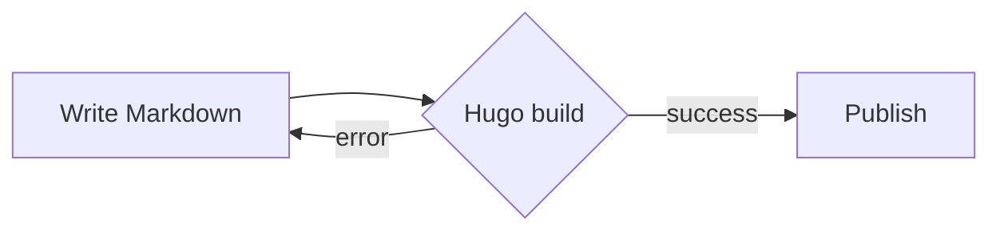

This site is built with [Hugo](https://gohugo.io/) and the
[Hextra](https://imfing.github.io/hextra/) theme. Every page is a Markdown
file below `content/` in the
[KeYProject/key-docs](https://github.com/KeYProject/key-docs) repository.
A push to `master` rebuilds and republishes the site, so *you do not need to
install anything on your computer to write documentation* — only to preview it
locally (see [Local build and preview](#local-build-and-preview)). Everything
below is used on this page, so copy from its source.

## Where content lives {#where-content-lives}

| Path | Purpose |
| :--- | :------ |
| `content/` | All pages. The directory structure determines the URLs. |
| `hugo.yaml` | Site configuration: menus, base URL, Markdown and math options. |
| `layouts/` | Local overrides of the theme: callout, snippet, citation and badge templates, Prism and MathJax. |
| `assets/` | Files processed by Hugo: shared Markdown snippets, CSS, Prism grammars. |
| `static/` | Files copied verbatim, e.g. `static/devel/KeYCodeStyle.xml`. |
| `data/refs.json` | Bibliography database used by citations. |
| `go.mod` | Pins the Hextra version (currently v0.13.0). |

The URL of a page is derived from its path: `content/user/faq.md` becomes
`/user/faq/`.

### Pages, sections and bundles

* **Regular page** — a single file, e.g. `content/devel/building.md` →
  `/devel/building/`.
* **Section landing page** — `_index.md` inside a directory, e.g.
  `content/devel/_index.md` → `/devel/`. Its title is the section name in the
  sidebar, and its `weight` orders the section among its siblings.
* **Leaf bundle** — a directory with an `index.md` and the page's assets
  next to it, e.g. `content/user/proving/proof-caching/index.md` plus
  `ProofCachingTree.png` → `/user/proving/proof-caching/`. Assets are
  referenced relatively: ``.

Use a bundle whenever a page has images, diagrams or downloads to ship; keep
single-file pages for prose only. A directory must not contain both `index.md`
and `_index.md`.

File and directory names become URLs, so use lowercase words separated by
hyphens. When you rename a page, keep old links working with an `aliases` entry
in the front matter, e.g. `aliases: ["/user/old-name/"]`.

The page title comes from the front matter field `title` — never from the file
name and never from a heading in the body. The theme renders it once as the
page `<h1>`; a `#` heading in the body would produce a second `<h1>` and break
the table of contents. Start the body with `##`.

## Page front matter {#front-matter}

Front matter is YAML between two `---` lines at the top of the file. A typical
page uses:

```yaml
---
title: "Proof Slicing"
weight: 40
author: "Arne Keller"
date: 2026-06-11
date_label: "June 2026"
valid_for: "KeY-2.12.0"
updated: "June 2026"
---
```

| Field | Required | Effect |
| :---- | :------- | :----- |
| `title` | yes | Sidebar entry and page heading. Quote it when it contains `:`. |
| `weight` | yes | Integer sort key among sibling pages, ascending. See [Navigation and weights](#navigation-and-weights). |
| `author` | no | Renders `Author: …` directly below the title. |
| `date` | no | Machine-readable date (`2026-06-11` or RFC3339). Used for ordering; no prose. |
| `date_label` | no | Free text shown in the author line, e.g. `"June 2023"`. Takes precedence over `date`. |
| `valid_for` | no | Version the page was written for; shown in parentheses after the author line. |
| `updated` | no | Free text; appended to the author line as `last updated: …`. |
| `approved` | no | Review state, see [Review badges](#review-badges). |
| `approved-on` | no | ISO date belonging to `approved` when the two are written separately. |
| `aliases` | no | List of old URLs that should redirect to this page. |

`date_label`, `valid_for` and `updated` are only rendered when `author` is also
set — without `author` the whole author block is skipped. A value in `date`
that Hugo cannot parse aborts the build, so keep prose dates out of it: put the
machine-readable date in `date` and the human-readable one in `date_label`.

## Navigation and weights {#navigation-and-weights}

The sidebar is generated from the content tree, not from a configuration file.
Within a section, pages are sorted by `weight` in ascending order; sections are
ordered the same way by the `weight` in their `_index.md`.

* Leave gaps (`10`, `20`, `30`, …) so that new pages can be inserted without
  renumbering everything.
* Set an explicit weight on **every** page of a section. Hugo treats a missing
  weight as `0`, which sorts *before* all weighted pages, so an unweighted page
  silently jumps to the top of the sidebar.
* Do not encode ordering in the title. Titles such as `1. Architecture` are
  legacy labels; new pages use a plain title and rely on `weight`.
* The navbar (Home, User Guide, …) comes from `menu.main` in `hugo.yaml`.

For example, the Developer Guide currently orders its sections as
`architecture` (10), `building` (20), `releasing-central` (30),
`working-on-code` (40), `extending` (50), `library` (60), `internals` (70),
`testing` (80), this page (90) and `appendix` (100).

## Review badges {#review-badges}

The documentation was revised in June 2026 with support from generative AI.
Every hand-written page therefore carries a review state until a KeY core team
member signs it off. The state is derived from `approved` alone:

| Front matter | Result |
| :----------- | :----- |
| `approved` missing or empty | Amber pill `⚠ not yet verified` at the top of the page, floated right. |
| `approved: mu 2026-06-19` | Green note in the page footer: `✓ This page was checked by mu on 2026-06-19.` |
| `approved: mu` | Same green note, without a date. |
| `approved: mu` plus `approved-on: 2026-06-19` | Same green note, with the date from `approved-on`. |
| `approved: none` | No badge at all (used for generated and index pages). |

The footer of this page shows the green variant. The badge is rendered by
`layouts/_partials/custom/content-begin.html` and `content-end.html`; the
styling lives in `assets/css/custom.css`.


Only the person who actually read the page may be named in `approved`. Never
add initials on someone else's behalf, and do not copy the `approved` line from
another page. If you have reviewed a page, add your own initials and today's
date; otherwise leave the field out and the amber badge stays visible.


## Text features {#text-features}

Ordinary Markdown works as expected: paragraphs, emphasis (`*italic*`,
`**bold**`), `` `inline code` ``, `[links](../building/)`, blockquotes and
nested lists. A few extensions are enabled in `hugo.yaml` and worth using.

### Headings and anchors

Use `##` for sections and `###`/`####` below it. Add an explicit anchor when
other pages need to link to a specific section:

```markdown
### Application of a taclet {#sec:taclet-application}
```

The id is used verbatim: `#sec:taclet-application` within the page,
`<other-page>/#sec:taclet-application` from another one. Without an explicit
id, Hugo derives a slug from the heading text.

Links between pages are written without the file extension
(`[Building KeY](../building/)`). The theme resolves `.md` links too, so
`../building.md` also works — the extension-less form is house style, not a
requirement.

### Tables

```markdown
| Method | Description |
| :----- | :---------- |
| `GET` | Fetch a resource |
| `PUT` | Update a resource |
```

| Method | Description |
| :----- | :---------- |
| `GET` | Fetch a resource |
| `PUT` | Update a resource |

Cells may contain inline Markdown and raw HTML, including icons:
 supported,  not supported.

### Icons

`` inserts an inline SVG:  or .
Names come from Hextra's bundled icon set; a site-local `data/icons.yaml` can
add more (`key`, `check-circle`, `paper-airplane`, …). `lucide:rocket` and
`tabler:brand-github` use a remote provider fetched at build time. An unknown name is a hard build
error (`icon "…" not found`), so typos surface immediately.

### Lists

```markdown
- an unordered item
- another one

1. first step
2. second step
```

Task lists use checkboxes and are not interactive:

- [x] reviewed by a team member
- [ ] still waiting for review

### Definition lists

```markdown
`weight`
:   Sort key among sibling pages, ascending.

`title`
:   Name in the sidebar and page heading.
```

`weight`
:   Sort key among sibling pages, ascending.

### Footnotes

A footnote reference is `[^label]`; the definition can live anywhere in the
file and is rendered at the bottom of the page.[^footnote-demo]

### Raw HTML

The Markdown renderer is configured with `unsafe: true`, so raw HTML passes
through: press <kbd>Ctrl</kbd>+<kbd>S</kbd> to save. Use this sparingly and
prefer Markdown when it can express the same thing.

## Callouts and details {#callouts-and-details}

A callout is a coloured box for side remarks. The shortcode is
`` with the content in the body and a closing
``. Content is rendered as Markdown, so lists and code
fences work inside.


`default` (green, light bulb), `info` (blue, information), `warning` (amber,
exclamation), `error` (red, ban) and `important` (purple, exclamation circle).
An unknown type falls back to `default`.


The local override in `layouts/_shortcodes/callout.html` adds a `title`
parameter, which the upstream theme does not have:

```markdown

Split a page once it needs more than a screen of scrolling.

```

Rendered result:


Split a page once it needs more than a screen of scrolling.


Without `title=`, the box shows just the icon next to the content. You can
also pass `icon=` or `emoji=` to replace the default symbol.

### Collapsible details

For optional asides use the `details` shortcode. Its content is Markdown as
well; `closed="true"` starts the block collapsed instead of open.

```markdown
{}
Markdown has no alignment attribute; use a raw HTML `figure` instead.
{}
```

{}
Markdown has no alignment attribute; use a raw HTML `figure` instead (see
[Images and downloads](#images-and-downloads)).
{}

{}
Pass `closed="true"` to hide optional material until the reader opens it.
{}

## Code blocks {#code-blocks}

Fenced code blocks are highlighted in the browser by
[Prism.js](https://prismjs.com/). Chroma is still configured in `hugo.yaml`, but
`layouts/_partials/components/codeblock.html` bypasses it for fences and emits
a `language-…` class instead, so there is no server-side highlighting. Put the
language directly after the opening fence:

````markdown
```java
public void pay(int amount) {
    balance -= amount;
}
```
````

```java
public void pay(int amount) {
    balance -= amount;
}
```

The following fence languages are wired up in
`layouts/_partials/components/codeblock.html`:

| Fence | Use for |
| :---- | :------ |
| `java` | Java source |
| `jml` | JML specifications |
| `key` | KeY problem files and taclets |
| `python`, `bash`, `yaml`, `json` | scripts and configuration |
| `javascript`, `js` | JavaScript source |
| `lisp`, `elisp`, `emacs` | Lisp source |
| `markdown` | Markdown examples (as on this page) |
| `text` | plain text, ASCII art, command output |
| `diff-<lang>` | a diff (`-`/`+` lines) highlighted with `<lang>`, e.g. `diff-java`, `diff-key`, `diff-text` |

A few more grammars are bundled (`c`, `cpp`, `css`, `html`/`xml`, `latex`,
`groovy`, `ocaml`, `properties`). Aliases: `shell`/`sh` → `bash`, `c++` → `cpp`,
`yml` → `yaml`. Any other language renders uncoloured but without error.
Supporting a new one means vendoring `prism-<lang>.min.js` into `assets/js/prism/`,
listing it in `layouts/_partials/custom/head-end.html`, and adding the fence
alias to the map in `components/codeblock.html`.

### Diffs {#diffs}

Use a `diff-<lang>` fence for diffs. Lines starting with `-` are marked as
removed and lines starting with `+` as added; a leading space marks an unchanged
line, which keeps the inner language's highlighting. For example:

````markdown
```diff-json
 \proofObligation {
-       "contract": "simple_evoting.Server[java.lang.Object::<inv>()].JML accessible clause.0",
+       "contract": "simple_evoting.Server[java.lang.Object::$inv()].JML accessible clause.0",
         "class": "de.uka.ilkd.key.proof.init.DependencyContractPO",
  }
```
````

```diff-json
 \proofObligation {
-       "contract": "simple_evoting.Server[java.lang.Object::<inv>()].JML accessible clause.0",
+       "contract": "simple_evoting.Server[java.lang.Object::$inv()].JML accessible clause.0",
         "class": "de.uka.ilkd.key.proof.init.DependencyContractPO",
  }
```

Inline code uses single backticks: `` `key` ``.

## Tabs {#tabs}

Tabs group alternative views of the same thing, typically two languages or a
description next to an example. The first tab is selected by default;
`selected=true` on a `tab` selects another one. Tab selection can be
synchronised across the page with `tabs.sync` in the front matter (or
`params.page.tabs.sync` in `hugo.yaml`).

```markdown


…


…


```

Rendered result:



```java
public class PayCard {
    private int balance;

    public void pay(int amount) {
        balance -= amount;
    }
}
```


```jml
/*@ normal_behavior
  @ requires amount > 0;
  @ ensures balance == \old(balance) - amount;
  @*/
public void pay(int amount);
```



A `tab` also takes `icon=`; keep tab contents short — a tab should not scroll.

## Mathematics {#mathematics}

Math is typeset by [MathJax](https://www.mathjax.org/). Exactly two delimiter
pairs are enabled: `$…$` for inline math and `$$…$$` on separate lines for
display math.

```latex
$$
\operatorname{ker} f = \{g \in G : f(g) = e_H\}
$$
```

$$
\operatorname{ker} f = \{g \in G : f(g) = e_H\}
$$

The homomorphism $f$ is injective if and only if its kernel is the singleton
set $\{e_G\}$.


`\(…\)` and `\[…\]` are deliberately *not* math delimiters here: KeY program
modalities are written exactly that way and must stay literal in code and
prose. Always use dollar signs for mathematics.


## Mermaid diagrams {#mermaid}

A fenced `mermaid` block is rendered as a diagram; no front matter flag is
needed, the theme loads Mermaid automatically when a page contains one.

````markdown

````


Flowcharts, sequence diagrams, state diagrams, class diagrams and
entity-relationship diagrams are all supported. Diagrams are drawn in the
browser, so they do not appear in plain-text exports. For ASCII art use a
`text` fence: it is uncoloured and keeps its alignment.

## Citations {#citations}

The bibliography is generated from `refs.bib` into `data/refs.json` by
`scripts/bib_to_json.py`. To cite a new work, add its BibTeX entry to
`refs.bib`, regenerate the data file, and commit both:

```bash
python3 scripts/bib_to_json.py refs.bib data/refs.json
```

Then cite by key — the shortcode renders the surnames plus the year:

```markdown
The KeY book  describes the calculus in detail.
```

The KeY book  describes the calculus in detail.

The reference list itself comes from ``, which renders
every entry sorted by key with an anchor `#ref-<KEY>`. It already lives on the
[Quicktour page](../../user/getting-started/quicktour/#bibliography); `cite`
links there, or locally when the page renders the list. An unknown key only
emits a warning, so check the build log.

## Shared snippets {#snippets}

Content that appears on several pages (for example the strategy cost table) is
kept once under `assets/snippets/` and included where needed:

```markdown

```

The file is rendered as Markdown at the point of inclusion:

{}

{}

Update the snippet once and every page follows — nothing drifts. Real use:
[Strategy Costs](../internals/proof-search/strategy-costs/).

## Images and downloads {#images-and-downloads}

Page-specific images belong in the page bundle, next to `index.md`, and are
referenced relatively. A Markdown image with a title renders as a figure with
a caption:

```markdown

```


Use descriptive alt text — it is what screen readers and search engines see.
Files shared by many pages live in `static/` and are referenced by an absolute
site path such as `/images/key.png` (Hugo's render hook resolves it against
`baseURL`). For more markup than a caption — a width, say — write a raw HTML
figure without a `markdown` attribute. Raw HTML is **not** rewritten by Hugo,
so keep the src bundle-relative; a root-absolute `/…` would point outside the
deployed sub-path and 404:

```html
<figure>
  
  <figcaption>The KeY logo, embedded as raw HTML.</figcaption>
</figure>
```

<figure>
  
  <figcaption>The KeY logo, embedded as raw HTML.</figcaption>
</figure>

Downloads follow the same rule: a bundle file is linked relatively
(`[quicktour.zip](quicktour.zip)`), a shared file under `static/` by absolute
path (`[KeYCodeStyle.xml](/devel/KeYCodeStyle.xml)`).

## Local build and preview {#local-build-and-preview}

You need [Hugo extended](https://gohugo.io/installation/) 0.146 or newer (CI
pins 0.161.1), a Go toolchain for the Hextra module, and
[lychee](https://github.com/lycheeverse/lychee#installation) for the link check.

```bash
make prepare   # hugo mod tidy — resolve the Hextra module
make serve     # hugo server --logLevel debug --disableFastRender -p 1313
make build     # hugo --gc --minify, output in public/
make check     # build to /tmp/keydocs-check, then lychee link check
```

`make serve` listens on <http://localhost:1313> and reloads on change. Without
`make`, the same commands are:

```bash
hugo server --logLevel debug --disableFastRender -p 1313
hugo --gc --minify
```

`hugo server` renders shortcodes, math and Prism highlighting exactly as the
deployed site does. Never edit files under `public/` — they are overwritten on
the next build. `make check` rebuilds with `--baseURL "/"` so that lychee can
resolve absolute paths, and checks only links into the generated site
(`--offline`). The sidebar's *Edit this page* link opens the page source under
`content/`.

## Deployment {#deployment}

`.github/workflows/pages.yaml` builds the site with `hugo --gc --minify` on
every push to `master` or `main`, on pull requests, and weekly for the
generated proof-script reference; only `master` deploys, to GitHub Pages at
<https://keyproject.github.io/key-docs/>.

* Template and shortcode errors, unknown icon names and unparsable `date`
  values abort the build, so CI catches them before merging.
* An unknown citation key only emits a warning: the build passes and the page
  shows `[KEY]`.
* Broken internal links are caught by `make check` (lychee), not by the CI
  build — run it before pushing.
* `public/` and `resources/` are build output; never commit them.

## Common mistakes {#common-mistakes}

* A `#` heading in the body — the title already is the `<h1>`. Use `##`.
* A page without `weight` — it sorts to the top of its section.
* A non-parsable `date` such as `June 2023` — it aborts the build; use ISO or
  RFC3339 in `date` and put prose in `date_label`.
* A copied `approved` line naming somebody else — only the reviewer signs off.
* `\(…\)` or `\[…\]` used as math delimiters — use `$…$` and `$$…$$`.
* A root-absolute `/…` src in raw HTML — it bypasses `baseURL` and 404s; use a
  `./…` bundle path instead.

[^footnote-demo]: Footnotes are numbered automatically and collected at the
    bottom of the page; use them for asides, not for essential information.
