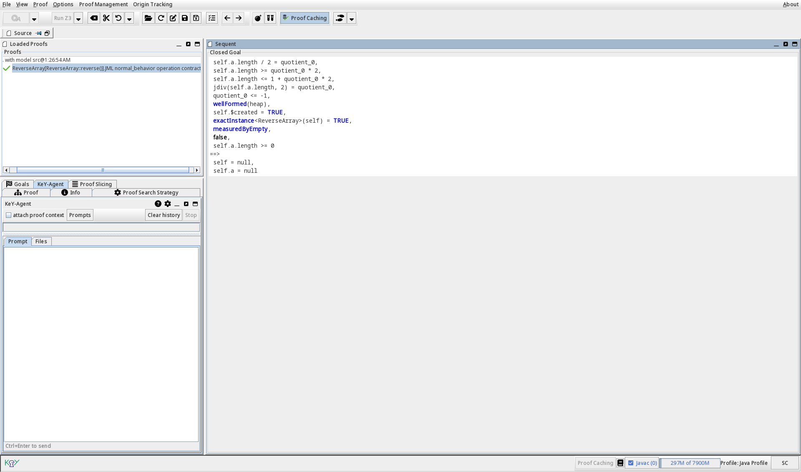
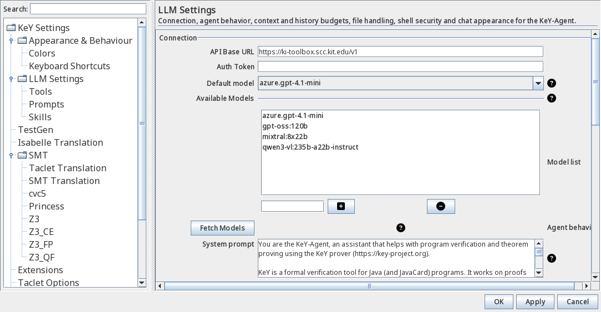
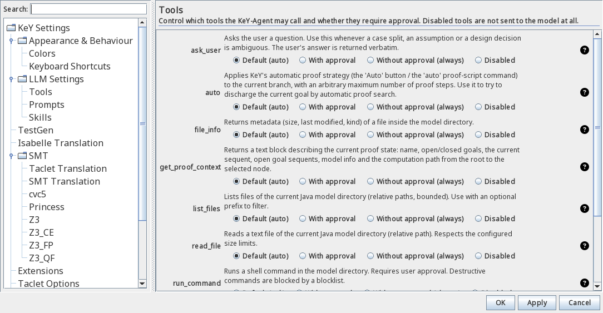

KeY comes with an integrated AI assistant, the **KeY-Agent**: a chat panel docked in the
main window that answers questions about your current proof, can inspect the Java model
and the sequent, and can run proof-script commands such as `tryclose` and `auto` on your
behalf. It works with any OpenAI-compatible chat-completions service; by default KeY uses
the LLM service operated by KIT (`https://ki-toolbox.scc.kit.edu/v1`).

{}
The KeY-Agent is currently part of the development version of KeY and is not contained in
a released version yet.
{}

{}
Prompts, the attached proof context and selected files are sent to the configured LLM
service and may be processed and stored there. Only share content that you are allowed to
disclose, and prefer a service operated by your institution for confidential code.
{}

## Features

- **Chat about the current proof** — the agent sees the proof name, status, the current
  sequent and the open goals on request, and keeps a separate conversation for every proof.
- **Tool calls with approval** — the agent can execute proof tools; every sensitive action
  asks for your permission first, and you can disable tools entirely.
- **Proof automation** — `tryclose` attempts to close the current goal or branch
  automatically, `auto` runs KeY's automatic strategy for a bounded number of steps.
- **Taclet management** — list the available taclets and taclet options of any open proof,
  export them as parseable rule text, and add or remove taclets (changes require your
  approval).
- **Code access** — tick files in the *Files* tab or reference them directly in the prompt;
  file contents are embedded into the request (no extra round trip).
- **Reusable prompts and skills** — save your own prompt templates and background
  knowledge, and activate them per turn.
- **Sub-agents** — hand off isolated tasks (closing goals, inspecting files) to bounded
  child agents with their own tool whitelist; several tasks can run in parallel, and the
  sub-agent activity is recorded in a log the agent can consult.
- **Input assistance** — autocompletion for context tokens, files and commands; press
  Ctrl+Space to expand a token inline.

## Configuration

Open *Options → Settings* and select **LLM Settings** in the left-hand tree. All values are
optional; the defaults work out of the box once a valid token is set.

1. **API Base URL** — the OpenAI-compatible endpoint of your service. The default points to
   the KIT service; point it to your institution's endpoint or any other
   OpenAI-compatible API.
2. **Auth Token** — your API key for that service, issued by the operator of the service.
3. **Default model** — the model to talk to. *Fetch Models* queries the service's model
   list and fills **Available Models**; you can also type entries manually and switch the
   model per proof from the panel's title menu.
4. Everything else (system prompt, temperature, history and file budgets, shell policy) has
   sensible defaults; the full reference is linked at the bottom of this page.

### Tool permissions

The **Tools** sub-page decides what the agent may do and what needs your approval:

Every tool has four modes: **Default (ask)** — follow the tool's own requirement,
**With approval**, **Without approval (always)**, and **Disabled** — the tool is not even
offered to the model. For example, set `run_command` to *Disabled* if the agent should
never touch a shell, or give `tryclose` *Without approval* if the agent may prove freely.

## How to use

### Opening the agent

The panel is visible from the start as the dock tab **KeY-Agent** (lower left, next to
*Goals*); *Proof → LLM → Open LLM prompt* or Ctrl+K focuses it. Each proof gets its own
conversation; the history is kept while KeY is running.

### Sending prompts

Type into the **Prompt** box and send with Ctrl+Enter (Shift+Enter inserts a line break).
Tick **attach proof context** to include the current sequent and goal automatically. While
the agent is working, **Stop** cancels the turn; **Clear history** starts a fresh
conversation.

### Referring to code and proof state

- **Files tab** — the files of the Java model appear as checkboxes; selected files are
  attached to the conversation.
- **`@src/MyClass.java`** — embeds a file (relative to the Java model directory) into the
  message as a code block.
- **`$seq`**, **`$goals`**, **`$proof`**, **`$proofName`**, **`$selectedFiles`** — insert
  the current sequent, open goals, a proof summary, the proof name, or the list of attached
  files.
- Type `$`, `@` or `/` to get autocomplete suggestions; Ctrl+Space expands the token at the
  caret.

### Approvals and questions

When the agent wants to execute a sensitive tool, an **approval box** appears with
*Allow once*, *Always allow*, and *Deny* — "always" is remembered for the rest of the
session and can be revoked in the Tools settings. The agent may also ask you a direct
question (**ask_user** tool); answer it in the chat and the turn continues.

### Reusable prompts and skills

The **Prompts** button (and the `/prompts` command) opens the prompt library, where you can
create, edit and import prompt templates; `/prompt:name` inserts a template into the input.
**Skills** are bundles of instructions and allowed tools that act as background knowledge;
`/skill:name` activates one for the current turn (the setting **Agent may use skills** must
be enabled). Both libraries are edited in the settings under *LLM Settings → Prompts* /
*Skills*. Each entry is stored as one Markdown file with YAML front matter — under
`~/.key/<version>/llm/prompts/` and `~/.key/<version>/llm/skills/` respectively; JSON
files from older versions are migrated automatically on first access, and
*Import/Export* exchanges a ZIP archive of these Markdown files.

### Sub-agents

Bounded child agents with a dedicated role (`goal-solver`, `file-explorer`,
`rule-designer`): each runs its own tool-calling loop under a separate message thread and
is restricted to the tools of its role's whitelist. To use them, enable *Agent may spawn
sub-agents* in the LLM settings; a delegation asks for your approval and then runs
autonomously (children never pause for approvals). A single task runs in `sequential`
mode, an array of independent tasks can run concurrently in `parallel` mode. The runs are
recorded in a per-session log that the agent itself can read back (`get_subagent_logs`),
and the chat panel shows the sub-agent tasks indented under the activity summary.

## Troubleshooting

| Problem | Remedy |
|---------|--------|
| Connection failed / HTTP 401 | Check **API Base URL** and **Auth Token**; corporate proxies may need exceptions. |
| The model list stays empty | *Fetch Models* needs a valid token and a reachable endpoint. |
| The agent cannot read a file | Files must live in the Java model directory; large files are skipped (size caps in the settings). |
| The agent runs shell commands | Disable `run_command` in the Tools settings, or adjust the blocklist patterns. |
| History is gone | Conversations are kept per proof in memory only; they do not survive a restart. |

The complete settings reference, the full list of input tokens and the architecture notes
are in the [KeY-Agent documentation](https://github.com/KeYProject/key/blob/weigl/llm/key-agent-doc.md)
(KeY repository, `key-agent-doc.md`).
