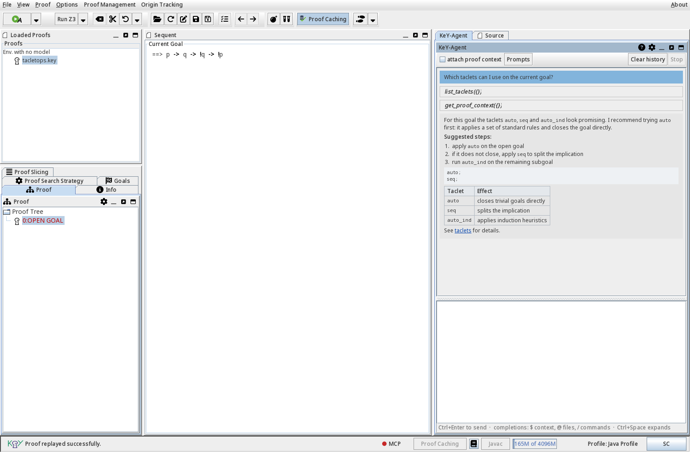
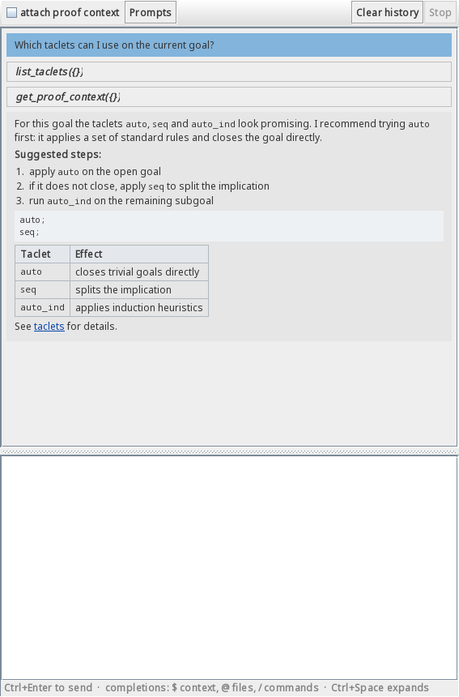
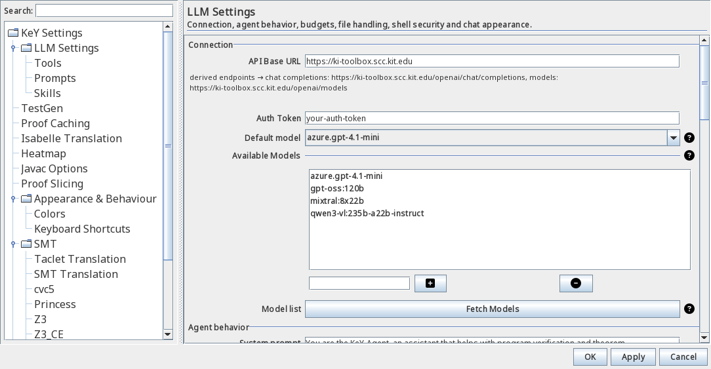
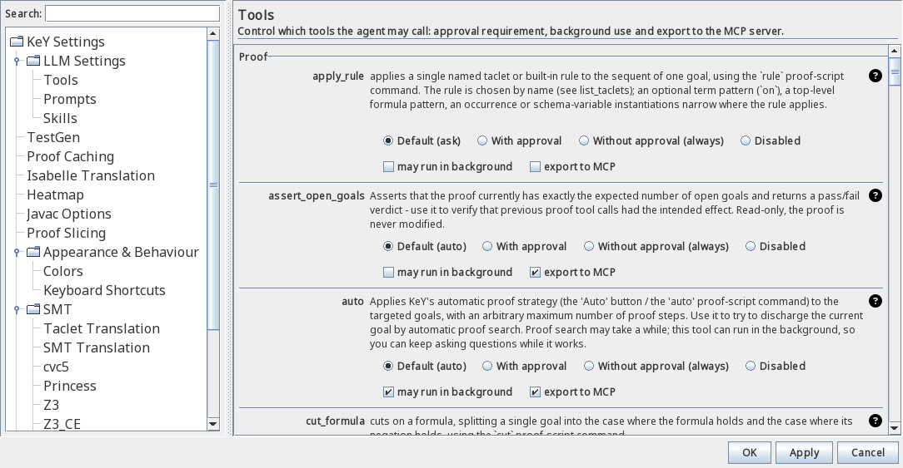

# LLM Support (KeY-Agent)

KeY comes with an integrated AI assistant, the **KeY-Agent**: a chat panel docked at the
right side of the main window that answers questions about your current proof, can inspect
the Java model and the sequent, and can run proof commands such as `tryclose` and `auto` on
your behalf. It works with any OpenAI-compatible chat-completions service; by default KeY
uses the LLM service operated by KIT (`https://ki-toolbox.scc.kit.edu`).

{ width="800" }

!!! info "Availability"

    The KeY-Agent is currently part of the development version of KeY and is not contained
    in a released version yet.

!!! warning "Your data leaves your machine"

    Prompts, the attached proof context and selected files are sent to the configured LLM
    service and may be processed and stored there. Only share content that you are allowed
    to disclose, and prefer a service operated by your institution for confidential code.

## Features

- **Chat about the current proof** — the agent sees the proof name, status, the current
  sequent and the open goals, and keeps a separate conversation for every proof.
- **Markdown answers** — the agent's answers are rendered as Markdown: headings, lists, code
  blocks and tables are formatted, and links open in the system browser. Rendering is strictly
  offline: external images or stylesheets are never fetched, and raw HTML in an answer is shown
  as plain text rather than interpreted.

{ width="500" }
- **Tool calls with approval** — the agent can execute proof tools; every sensitive action
  asks for your permission first, and you can disable tools entirely.
- **Proof automation** — `tryclose` attempts to close the current goal or branch
  automatically, `auto` runs KeY's automatic strategy for a bounded number of steps, and
  further tools apply single rules, run proof scripts, fork the proof, edit sequents and
  probe candidate formulas.
- **Taclet management** — list the available taclets and taclet options of any open proof,
  export them as parseable rule text, and add or remove taclets (changes require your
  approval).
- **Compact tool set** — the everyday tools (files, shell, questions, skills) are always
  offered; the KeY-specific Proof and Taclet tools are loaded on demand, so the model only
  sees what it needs. The agent tells you when it does this (`list_tools`).
- **Code access** — reference files with `@src/MyClass.java` to embed them into the message,
  or let the agent use the `list_files`, `read_file`, `edit_file` and `file_info` tools.
- **Reusable prompts and skills** — save your own prompt templates and background
  knowledge, and activate them per turn.
- **Input assistance** — autocompletion for context tokens (`$`), files (`@`) and commands
  (`/`); press ++ctrl+space++ to expand a token inline and ++ctrl+enter++ to send the prompt
  from anywhere in the panel.
- **KeY MCP server** — optionally expose the agent's tool set over the Model Context
  Protocol (SSE) on the loopback interface, so external MCP clients such as Claude Desktop
  can inspect and drive your proof, too.
- **Sub-agents** — hand off isolated tasks (closing goals, inspecting files) to bounded
  child agents with their own tool whitelist. Currently disabled by default.

## Configuration

Open *Options → Settings* and select **LLM Settings** in the left-hand tree. All values are
optional; the defaults work out of the box once a valid token is set.

{ width="800" }

1. **API Base URL** — the OpenAI-compatible endpoint of your service. The default points to
   the KIT service; point it to your institution's endpoint or any other
   OpenAI-compatible API.
2. **Auth Token** — your API key for that service, issued by the operator of the service.
3. **Default model** — the model to talk to. *Fetch Models* queries the service's model
   list and fills **Available Models**; you can also type entries manually. The model used
   for a proof can be switched at any time from the panel's title menu (*Models* submenu).
4. **Agent behavior** — the agent's system prompt, whether it may ask you questions
   (*ask_user*, on), use skills (*use_skill*, off) or consult the LLM about its own
   reasoning (*ask_llm*, on), and the per-turn budget of tool-calling rounds (8).
5. Everything else (context and history budgets, file handling, shell policy, MCP server,
   user interface) has sensible defaults; the full reference is linked at the bottom of this
   page.

### Tool permissions

The **Tools** sub-page decides what the agent may do, what needs your approval, and what is
shared with external MCP clients:

{ width="800" }

Every tool row offers four permission modes: **Default (ask)** or **Default (auto)** —
follow the tool's own requirement, **With approval**, **Without approval (always)**, and
**Disabled** — the tool is not even offered to the model. For example, set `run_command` to
*Disabled* if the agent should never touch a shell, or give `tryclose` *Without approval*
if the agent may prove freely. The **may run in background** checkbox allows long-running
calls to continue in the background while you keep chatting, and **export to MCP** decides
whether the tool is offered on the KeY MCP server. Only the KeY-specific tools (Proof and
Taclets) can be exported — the export checkbox of the standard tools (files, shell, …) is
disabled, because those are private to the chat panel. By default the auto-approved
KeY-specific tools are exported, everything that asks before running stays off.

## How to use

### Opening the agent

The panel is visible from the start as the dock tab **KeY-Agent** at the right side of the
main window; *Proof → LLM → Open LLM prompt* (++ctrl+p++) focuses it. The tab menu offers
*Switch Orientation* to re-dock the panel (left, bottom or right) and a *Models* submenu to
switch the model of the current proof. Each proof gets its own conversation; the history is
kept in memory while KeY is running.

### Sending prompts

Type into the input box at the bottom of the panel and send with ++ctrl+enter++ (it works
from anywhere in the panel, even while the conversation has the focus; ++shift+enter++
inserts a line break). Tick **attach proof context** to include the current sequent and
goal in every prompt automatically (off by default; the size budgets are in the settings).
While the agent is working, **Stop** cancels the turn; **Clear history** starts a fresh
conversation; the **Prompts** menu inserts a saved prompt template.

### Referring to code and proof state

- **`@src/MyClass.java`** — embeds a file (relative to the Java model directory) into the
  message as a code block.
- **`$seq`**, **`$goals`**, **`$proof`**, **`$proofName`**, **`$computePath`**,
  **`$model`**, **`$classpath`**, **`$bootClasspath`**, **`$selectedFiles`**, **`$input`**
  — insert the current sequent, open goals, a proof summary, the proof name, the proof's
  compute path, the Java profile, class paths, the list of attached files, or the prompt
  text itself.
- Type `$`, `@` or `/` to get autocomplete suggestions; ++ctrl+space++ expands the token at
  the caret. The `/` commands open the **Prompts** and **Skills** libraries
  (`/prompts`, `/skills`) and activate entries by name (`/prompt:name`, `/skill:name`).

### Approvals and questions

When the agent wants to execute a sensitive tool, an **approval box** appears with
*Allow once*, *Always allow*, and *Deny* — "always" is remembered for the rest of the
session and can be revoked in the Tools settings. The agent may also ask you a direct
question (*ask_user*); answer it in the chat and the turn continues.

### Reusable prompts and skills

The **Prompts** menu (and the `/prompts` command) opens the prompt library, where you can
create, edit and import prompt templates; `/prompt:name` inserts a template into the input.
**Skills** are bundles of instructions and allowed tools that act as background knowledge;
`/skill:name` activates one for the current turn (the setting **Agent may use skills** must
be enabled). Both libraries are edited in the settings under *LLM Settings → Prompts* /
*Skills*. Each entry is stored as one Markdown file with YAML front matter — under
`~/.key/<version>/llm/prompts/` and `~/.key/<version>/llm/skills/` respectively; JSON
files from older versions are migrated automatically on first access, and
*Import/Export* exchanges a ZIP archive of these Markdown files. A skill that wants to use
Proof or Taclet tools must whitelist `list_tools` as well — the agent loads those tools on
demand via `list_tools` (this keeps the offered tool list compact) — and the shipped skills
do exactly that.

### The KeY MCP server

The status line at the bottom of the main window carries the **MCP** indicator (a red or
green dot next to the label). Click it to start or stop the **KeY MCP server**, which
exposes the agent's tool set over the Model Context Protocol using HTTP with
Server-Sent Events. By default it binds to the loopback interface (`127.0.0.1`) on a free
ephemeral port, so it is only reachable from your own machine; the host, port and an
optional bearer token can be changed under *LLM Settings → MCP server*. While the server
runs, hovering over the indicator shows the endpoint URL (click it to copy it to the
clipboard); point your MCP client (for example Claude Desktop) at that URL to use KeY's
proof tools from outside. The server exposes the **KeY-specific proof and taclet tools**;
which of them are offered is controlled per tool by the **export to MCP** permission (the
standard tools are private to the chat panel and never exported). Tool calls from external
clients are serialized with the GUI
agent's own tool calls, so both sides observe one consistent proof state.

### Tool console

*Proof → LLM → Tool Console…* opens the tool console: a table of all tools with their
category and description. Select a tool, fill in its arguments (the **JSON** checkbox
switches between the form generated from the tool's JSON schema and raw JSON), and press
*Execute*. Ticking **Approve tool execution** routes the call through the normal approval
prompt even for auto-approved tools.

### Sub-agents

Bounded child agents with a dedicated role (`goal-solver`, `file-explorer`,
`rule-designer`): each runs its own tool-calling loop under a separate message thread and
is restricted to the tools of its role's whitelist. The agent delegates via the
`spawn_subagent` tool, which asks for your approval and then runs autonomously (children
never pause for approvals). A single task runs in `sequential` mode, an array of
independent tasks can run concurrently in `parallel` mode. The runs are recorded in a
per-session log that the agent itself can read back (`get_subagent_logs`), and the chat
panel shows the sub-agent tasks indented under the activity summary. In the current
development version this feature is disabled by default.

## Troubleshooting

| Problem | Remedy |
|---------|--------|
| Connection failed / HTTP 401 | Check **API Base URL** and **Auth Token**; corporate proxies may need exceptions. |
| The model list stays empty | *Fetch Models* needs a valid token and a reachable endpoint. |
| The agent cannot read a file | Files must live in the Java model directory; large files are skipped (size caps in the settings). |
| The agent runs shell commands | Disable `run_command` in the Tools settings, or adjust the blocklist patterns. |
| MCP client cannot connect | The server binds to loopback only by default; check host and port in the MCP server settings, and the token if one is set. |
| History is gone | Conversations are kept per proof in memory only; they do not survive a restart. |

The complete settings reference, the full list of input tokens and the architecture notes
are in the [KeY-Agent documentation](https://github.com/KeYProject/key/blob/weigl/llm/key-agent-doc.md)
(KeY repository, `key-agent-doc.md`).
